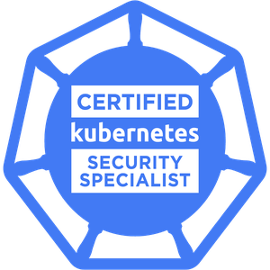
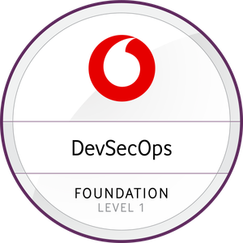
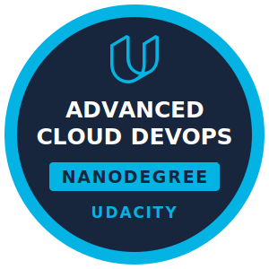
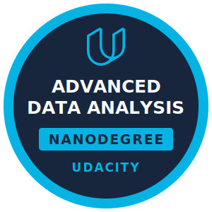

<h1 align="center">Ebraam Maher</h1>
<h3 align="center">Senior Cloud / DevOps Engineer</h3>

<table align="center">
<tr>
<td align="right"><b>Cloud</b></td>
<td>

</td>
</tr>
<tr>
<td align="right"><b>AI and LLM</b></td>
<td>

</td>
</tr>
<tr>
<td align="right"><b>Containers</b></td>
<td>

</td>
</tr>
<tr>
<td align="right"><b>IaC</b></td>
<td>

</td>
</tr>
<tr>
<td align="right"><b>CI/CD and GitOps</b></td>
<td>

</td>
</tr>
<tr>
<td align="right"><b>Security</b></td>
<td>

</td>
</tr>
<tr>
<td align="right"><b>Compliance</b></td>
<td>

</td>
</tr>
<tr>
<td align="right"><b>Monitoring</b></td>
<td>

</td>
</tr>
<tr>
<td align="right"><b>Databases</b></td>
<td>

</td>
</tr>
<tr>
<td align="right"><b>Languages</b></td>
<td>

</td>
</tr>
</table>

## Areas of expertise

<table align="center">
<tr>
<td align="center"><b>Multi Cloud Architecture</b></td>
<td align="center"><b>Kubernetes Platform Engineering</b></td>
<td align="center"><b>DevSecOps and Compliance</b></td>
</tr>
<tr>
<td align="center"><b>AI and LLM Platform Engineering</b></td>
<td align="center"><b>Infrastructure as Code</b></td>
<td align="center"><b>CI/CD and GitOps</b></td>
</tr>
<tr>
<td align="center"><b>Observability and Reliability</b></td>
<td align="center"><b>Cloud Cost Optimization</b></td>
<td align="center"><b>Cloud Migration and Modernization</b></td>
</tr>
</table>

## Certifications

 

## Achievements

- 🏆 Vodafone Stars Award, received twice for outstanding performance
- 🤖 Built enterprise LLM guardrails that audit every request and enforce corporate policies before it reaches a model
- 🔐 Remediated hundreds of vulnerabilities to reach a near zero vulnerability environment
